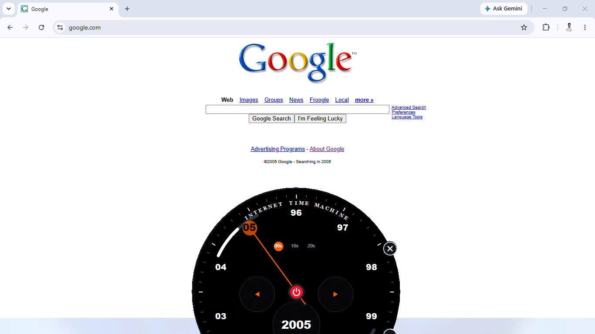

# Internet Time Machine (ITM)

The Internet Time Machine allows you to set your internet connection back to a previous point in time.

## Features
* Easy-to-use internet control interface.
* Reasonable internet speed.
* Setting a time limit for internet access.
* Resuming and pausing internet access.

## Platform Support
This official release is available for:
* **Windows (x64)**

## Screenshot

*Note: Dedicated builds for macOS and Linux ecosystems are currently in development.*

## Installation Instructions
1.  Download the **`ITM.zip`** file from the **Assets** section below.
2.  Launch the app to start traveling through time.
3.  *Note:* A stable internet connection is required to use the features.

---
